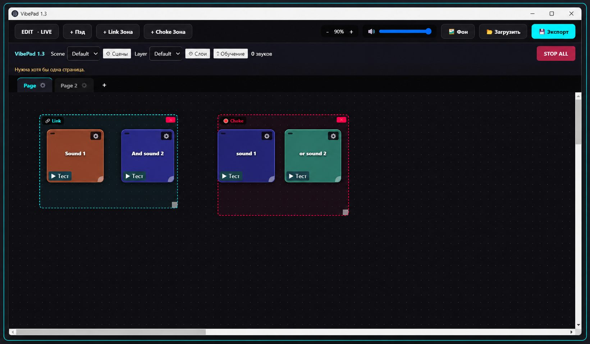

# M0leku1a

**Building desktop applications · Exploring AI and intelligent systems**

---

## About Me

I am a fourth-year bachelor's student in **Intelligent Systems in the Humanities (45.03.04)** and a developer building personal software products.

My academic interests include algorithms, mathematical logic and modeling, information processing, intelligent systems, and applied computing. I enjoy turning ideas into practical tools while learning more about software architecture, AI integration, and interactive systems.

## Working With

  

`JavaScript` · `Electron` · `HTML` · `CSS`

## Currently Exploring

- Large Language Models and local AI
- AI agents, automation, and AI-assisted development
- Software architecture and intelligent systems
- AI integration into desktop and interactive applications

## Selected Projects

### VibePad

A Windows desktop application built with JavaScript and Electron for playing and managing sounds through customizable pads. It supports pages and zones, hotkeys, project saving and loading, ZIP import and export, and visual customization with background images.

**Purpose:** to provide a flexible workspace for organizing and triggering audio during creative and interactive activities.

### DemForge

A personal project focused on generating content for tabletop role-playing games and interactive scenarios. Its development explores procedural generation, connected generators, contextual content creation, and the potential of local LLMs for producing more coherent results.

**Purpose:** to experiment with systems that help create descriptions, events, and world elements. Local LLM integration remains an area of research rather than a completed feature.

---

## Обо мне

Я студент четвёртого курса бакалавриата по направлению **45.03.04 — «Интеллектуальные системы в гуманитарной сфере»** и разработчик собственных программных продуктов.

В рамках обучения я работаю с алгоритмами, математической логикой и моделированием, обработкой информации, интеллектуальными системами и прикладными вычислительными задачами. Мне нравится превращать идеи в работающие инструменты и развиваться в архитектуре программ, интеграции ИИ и создании интерактивных систем.

## Использую

  

`JavaScript` · `Electron` · `HTML` · `CSS`

## Сейчас изучаю

- Большие языковые модели и локальный ИИ
- ИИ-агенты, автоматизацию и разработку с поддержкой ИИ
- Архитектуру программ и интеллектуальные системы
- Интеграцию ИИ в настольные и интерактивные приложения

## Избранные проекты

### VibePad

Настольное приложение для Windows на JavaScript и Electron, предназначенное для воспроизведения и управления звуками через настраиваемые пэды. Поддерживает страницы и зоны, горячие клавиши, сохранение и загрузку проектов, импорт и экспорт ZIP-архивов, а также визуальную настройку и фоновые изображения.

**Назначение:** создать гибкое рабочее пространство для организации и запуска аудио в творческих и интерактивных задачах.

### DemForge

Личный проект для генерации контента настольных ролевых игр и интерактивных сценариев. В проекте исследуются процедурная генерация, взаимодействие разных генераторов, использование контекста и возможности локальных LLM для получения более связного контента.

**Назначение:** экспериментировать с системами, помогающими создавать описания, события и элементы игрового мира. Интеграция локальных LLM остаётся направлением исследования, а не завершённой функцией.

